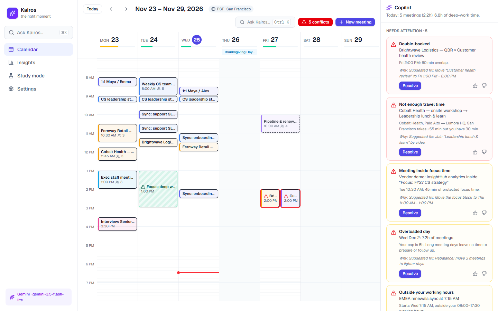
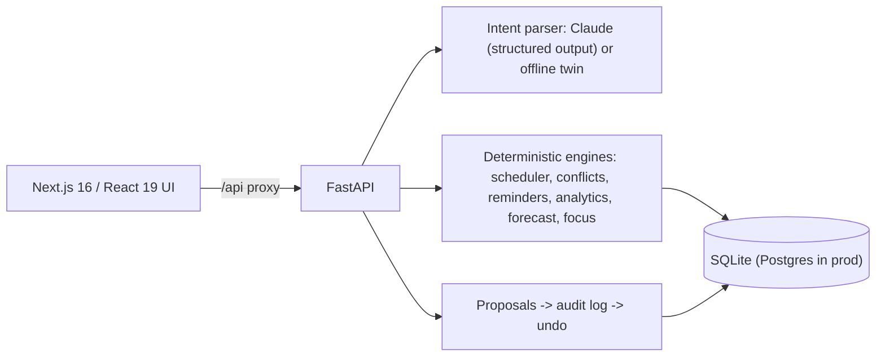

# Kairos: an AI-native calendar for business users

> **The LLM interprets. Deterministic engines decide. You stay in control.**



Kairos reimagines Google Calendar for business users.

- **Scheduling, fixing and preparing:** it schedules across time zones fairly, resolves conflicts before they bite, sizes reminders to what each meeting actually needs, and briefs you before you walk in.
- **Seeing ahead:** it forecasts next week's meeting load while there is still time to change it.
- **Language:** Claude turns plain language into structured intent and writes explanations, briefs and drafts.
- **Decisions:** tested, deterministic algorithms choose the times. Every suggestion explains itself.
- **Control:** every change is a proposal that is audit-logged and undoable in one click.

**The prototype is fully demoable offline.** With no API key, a deterministic twin of the AI layer takes over.

---

## What you can click

| ID | Feature | Status |
|---|---|---|
| F1 | **Intelligent scheduling**: language or form → ranked slots that are fair across time zones, each with its *why*; a relaxation ladder when nothing fits | Built |
| F2 | **Conflict resolution**: overlaps, impossible travel, focus intrusions, overloaded days and outside-hours meetings, each with ranked fixes, a preview and undo | Built |
| F3 | **Smart reminders + meeting briefs**: prep sized to importance and placed in real gaps, "leave now" from travel time, follow-ups, noise control | Built |
| F4 | **Predictive time analytics**: allocation, cost, fragmentation, and a 4-week forecast with an 80% interval and a model card | Built |
| F5 | **Focus guardian + calendar defrag**: protects the weekly focus goal and consolidates flexible meetings | Built |
| F6 | **Command bar (Ctrl+K)**: natural language to any of the above | Built |
| F7 | **Meeting necessity advisor**: shorten, go async, rotate time zones, with the message drafted | Built |
| F8 | **Learns your preferences**: slot ranking adapts to what you pick (bounded pairwise learning) | Built (simple) |
| F9–F11 | Task time-boxing · team load and fairness · external scheduling agent | Designed ([docs/02](docs/02-ai-features.md)) |

Also built: a change history with undo (Settings), Study mode for usability testing, an AI activity log, ICS import (including moved and deleted occurrences of recurring meetings; try [docs/samples/sample-import.ics](docs/samples/sample-import.ics)), a Google Calendar mapping (live OAuth sync needs your credentials), and demo controls (reset, simulated clock).

---

## Quick start

### Windows (tested on Windows 11)
Prerequisites: Python 3.11+, [uv](https://docs.astral.sh/uv/), Node.js 22+ and Git. See [REQUIREMENTS.md](REQUIREMENTS.md).

```powershell
powershell -ExecutionPolicy Bypass -File scripts\setup.ps1
```
```powershell
powershell -ExecutionPolicy Bypass -File scripts\dev.ps1
```
This opens http://localhost:3000. API docs are at http://127.0.0.1:8000/docs.

### macOS / Linux
```bash
scripts/setup.sh && scripts/dev.sh
```

### Docker (untested here: Docker Desktop wasn't running on the build machine)
```bash
docker compose -f infra/docker-compose.yml up --build
```

### Turn on an LLM (optional): Claude and/or Gemini
Copy `.env.example` to `services/api/.env`, set `ANTHROPIC_API_KEY=…` and/or `GEMINI_API_KEY=…`, and restart the API. The file is git-ignored; never commit keys.

- **Order:** Claude first when it has a key, then Gemini, then the offline engine. Each step is taken automatically on errors, timeouts or overload. With only a Gemini key, Gemini runs everything.
- **Models:** Claude `claude-opus-5-5` (schema-constrained output, server-side refusal fallback). Gemini `gemini-3.1-flash-lite` for parsing commands and `gemini-3.5-flash-lite` for briefs and drafts, both over the Gemini Developer API with JSON-schema output.
- **Status:** the sidebar pill switches from **Offline AI** to **Claude** or **Gemini**. Settings → *AI engine & activity log* shows every call (engine, model, latency, tokens, outcome; never content).
- **Quality check:** in `services/api`, run `uv run python -m evals.run_evals --claude` or `--gemini` to score an engine on the golden set. Measured on 26 Nov 2026, Gemini `gemini-3.1-flash-lite` got 84% of actions and 72% exact matches. Seven of its 14 misses were API errors or timeouts; in the app those fall back to the offline engine.

---

## A 5-minute demo

The demo data is a fictional company, Lumora. You are **Maya Chen, VP Customer Success (San Francisco)**, with colleagues in New York, London and Bangalore. Scenarios are planted on the next business days, so the demo never goes stale. The demo also respects public holidays: the build date was the eve of US Thanksgiving.

1. **Calendar**: red outlines mark conflicts. Focus blocks are hatched and locked. The Copilot rail lists what needs attention, each item with a *why*.
2. **Ctrl+K**: *"Find 45 min with Dev and Alex next week, mornings"*. You get interpretation chips, ranked slots with reasons and warnings, and everyone's local time. Click **Book**, then **Undo**.
3. **+ New meeting** with Priya (Bangalore) and Alex (New York): no shared working hours exist. Click *Stretch working hours* to see Kairos split the inconvenience fairly (e.g. 6:00 AM PT / 7:30 PM IST / 9:00 AM ET).
4. **Conflicts**: on the double-booked QBR, click **Preview** (a ghost appears on the calendar), then **Apply**. The internal review moves and the customer meeting stays.
5. **Next week → Cobalt Health onsite**: the reminder plan says *Leave by 8:55*, because of about 55 min of travel to Palo Alto plus a buffer. Prep is placed before you leave. The drawer also shows the brief, cost, and the priority breakdown. Try **Block prep time**.
6. **Copilot → Protect focus**: review the proposal and apply it.
7. **Insights**: the forecast band, model card, heatmap and fairness report. *Shorten "Weekly CS team meeting" to 45 min* applies the change and drafts the note.
8. **Study mode**: run task T1 with a participant code, rate SEQ, and export CSV.

More screenshots: [command bar](docs/screenshots/command-bar.png) · [schedule assistant](docs/screenshots/schedule-assistant.png) · [conflict center](docs/screenshots/conflict-center.png) · [event drawer](docs/screenshots/event-drawer.png) · [insights](docs/screenshots/insights.png) · [settings](docs/screenshots/settings.png) · [study mode](docs/screenshots/study.png)

---

## Architecture at a glance



The full design covers algorithms, AI layer, privacy, the production architecture and the tech stack. See [docs/04-technical-architecture.md](docs/04-technical-architecture.md) and the [ADRs](docs/adr/).

---

## Verified quality (25 Nov 2026, this machine)

| Check | Result |
|---|---|
| Backend tests (`pytest`): engines, API, undo safety, what each privacy setting lets reach the model, Claude and Gemini gateway contracts with fakes, Hypothesis property test that hard constraints are never violated | **83 passed** |
| End-to-end flows (Playwright driving Microsoft Edge, 1440×900, browser in Asia/Kolkata to prove time-zone handling) | **10 passed** |
| Web: `tsc`, ESLint (incl. React Compiler rules), Vitest (DST and layout), Next.js production build | **clean · 5 passed · builds** |
| NL-command golden set (51 cases incl. a prompt-injection case), offline parser | 100% action accuracy *(written alongside the parser; held-out cases from user testing are the real test)* |
| Forecast backtest (synthetic data, rolling origin) | Competitive with the best naive baseline (MAE ~1.1 h); reported as-is in the in-app model card |
| Scheduler latency | 135–331 candidate times checked in 2–42 ms per request (12 sampled requests) |

**Not verified here:**
- **Live Claude calls:** no API key on the build machine. The contract is unit-tested.
- **Live Google OAuth sync:** needs your Google Cloud client.
- **Docker images:** the daemon wasn't running.
- **The GitHub Actions workflow:** not pushed anywhere.

---

## Repository map

```
apps/web/            Next.js app (calendar, command bar, drawers, insights, settings, study mode)
services/api/        FastAPI: app/engines (decisions), app/ai (Claude + offline twin), app/api (routes)
  tests/  evals/     83 backend tests · NL golden set + runner
tests/e2e/           Playwright flows (Edge) - also regenerates docs/screenshots
docs/                01 research · 02 AI features · 03 prototype & flows · 04 architecture
                     05 user testing · 06 presentation · 07 agile roadmap · adr/
design/wireframes/   Low-fi annotated wireframe board (open index.html)
infra/  scripts/     Docker Compose · setup/dev/test scripts (PowerShell + bash)
```

## Documentation
1. [User research](docs/01-user-research.md): personas, pain points with sourced evidence, essential features, competitive landscape.
2. [AI features](docs/02-ai-features.md): specs F1–F11, value, RICE, autonomy model.
3. [Prototype & user flows](docs/03-prototype-and-flows.md), plus the [wireframe board](design/wireframes/index.html).
4. [Technical architecture](docs/04-technical-architecture.md) and [ADRs](docs/adr/).
5. [User testing plan](docs/05-user-testing-plan.md).

The presentation notes (06) and the agile roadmap (07) are internal and not published in this repository.

Also: [What is required](REQUIREMENTS.md).

## Environment notes (Windows)
- **OneDrive-synced folders:** `node_modules`, `.next`, `.venv` and the SQLite file live in `%LOCALAPPDATA%\kairos-ai-calendar` and are linked into the repo with junctions. Add npm packages with `scripts\web-npm.ps1 install <pkg>`.
  - The web app runs Next.js with `--webpack`, because Turbopack refuses files outside the project root.
- **Windows Application Control blocks some unsigned native files:**
  - It blocked SQLAlchemy's Cython accelerators, so `app/_compat.py` loads SQLAlchemy's identical pure-Python modules instead.
  - It also blocked uv's `.exe` launchers, so the scripts use `python -m …`.
- **Privacy:** Next.js telemetry is disabled in the scripts.

All people, companies and email addresses in the demo data are fictional.
