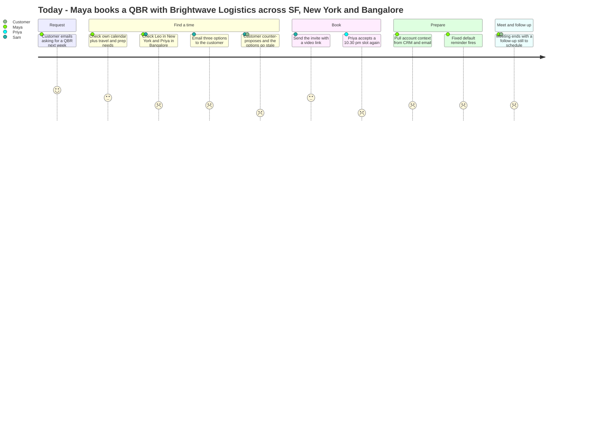

# 01 · User research

> **Status.** Desk research is complete; sources were checked on 25 Nov 2026. Primary research is planned, and its schedule lives in [05 · User testing plan](05-user-testing-plan.md).
> **Evidence rule.** Every number below links to its source and keeps the source's caveat. Personas, quotes and journeys are hypotheses until primary research confirms them. If a figure could not be verified, this document says so.

## 1. Summary

- **Meetings crowd out the work they exist to support.** 78% of 5,000 knowledge workers surveyed by Atlassian say they are expected to attend so many meetings that it is hard to get their work done ([E8](#6-evidence-table)). In Microsoft's 2023 survey of 31,000 workers, 68% say they lack enough uninterrupted focus time ([E7](#6-evidence-table)).
- **Cross-time-zone meetings are routine, and their cost falls unevenly.** In Microsoft 365 telemetry, 30% of meetings span several time zones, up 8 points since 2021, and meetings after 8 pm are up 16% year over year (E3, E4). Between San Francisco and Bangalore, no slot fits inside both offices' 9-to-6 day, so someone always stretches.
- **The calendar sees only part of the picture.** For the heaviest meeting users, 57–60% of meetings are ad hoc calls with no invite (E5). Any analytics we build must say what they cannot see.
- **Trust, not cleverness, is the bottleneck.** An explanation tends to raise trust whether or not the AI is right ([HAX G11][hax-g11]), and people do accept wrong AI outputs ([overreliance review][overreliance]). Kairos has to earn *calibrated* trust: it shows why, shows who pays, and can be undone in one click.
- **The market is moving into the suites.** Google (Jan and Mar 2026) and Microsoft (Apr 2026) now ship AI scheduling. Meanwhile standalone players have been acquired or closed: Reclaim went to Dropbox in 2024 and Clockwise shut down in Mar 2026 (§8). Kairos has to win on cross-suite coverage, fairness and reversibility.
- **One commonly quoted number does not hold up.** We found no rigorous public source for "emails needed to schedule one meeting" (E14). We will measure it in the diary study instead of quoting vendor estimates.

## 2. Research goals and method

| # | Goal | Decision it informs |
|---|---|---|
| G1 | Validate pains P1–P8 and rank their severity for each persona | Which features ship first (F1–F11) |
| G2 | Measure behavioural baselines: time-to-schedule, back-and-forth, focus hours, after-hours load, conflict rate | Targets in [05](05-user-testing-plan.md) and the OKRs in [07](07-agile-roadmap.md) |
| G3 | Map trust boundaries: what people let an AI do to their calendar, and at which autonomy level | Defaults for the autonomy dial |
| G4 | Map privacy thresholds: what calendar data users and admins will share with Kairos and with an LLM | Data-minimisation design, enterprise readiness |
| G5 | Confirm the table-stakes features without which business users won't switch | MVP scope, release plan |

| Method | Status / when | Sample | What it answers | Output |
|---|---|---|---|---|
| Desk research | **Done** (Nov 2026) | 15 evidence items (§6) plus a market scan (§8) | Prevalence of the pains; market state | This document |
| Semi-structured interviews (60 min, remote) | Dec 2026 | 15–20 people, 3–4 per persona; US, UK and India | Recent, specific episodes (critical-incident questions); jobs; trust and privacy boundaries | Updated personas; ranked pains |
| Survey | Jan 2027 | ≥ 300 business users at companies of 50–5,000 people; quotas by role and region | How common and how severe P1–P8 are per segment; autonomy preferences; willingness to grant calendar access | Segment sizing; prioritised pains |
| Consented calendar-log analysis | Jan–Feb 2027 | 30–50 volunteers (interviewees, survey opt-ins, design partners) | Behavioural baselines: meeting hours, fragmentation, cross-zone share, after-hours load per attendee, last-minute bookings, overlaps, reschedules | Baselines for the targets in 05 |
| Diary study (2 weeks) | Feb 2027 | 12–16 people, at least 2 per persona | Messages and elapsed time per scheduling episode; reminder usefulness; Kairos compared with each participant's own baseline week | In-situ evidence, the E14 measurement |

**How the calendar-log analysis protects people.** Participants run a script we provide on their own machine, against an ICS export of their calendar. The script outputs aggregates only: no titles, no attendee names, no descriptions. Where the export carries `CREATED` and `LAST-MODIFIED`, it also counts last-minute bookings and reschedules. Consent, retention and deletion follow §11 of [05](05-user-testing-plan.md).

**When a pain counts as validated.** A pain is validated for a persona when two things hold. First, at least half of that persona's interviewees describe a specific episode from the last 30 days. Second, the survey ranks it in that segment's top three. A pain that fails both tests is dropped or re-scoped.

## 3. Proto-personas (to validate)

These are **proto-personas** ([Gothelf, 2012][gothelf]): the team's assumptions, written down so that research can confirm or kill them. All five people work at **Lumora**, a fictional B2B SaaS company of about 400 people. The quotes are hypotheses, not participant quotes.

### Maya Chen · VP Customer Success, San Francisco · *demo user*
- **Context.** Runs customer success at Lumora. Most of her week is external: QBRs, escalations and renewals with customers such as Brightwave Logistics, Cobalt Health and Fernway Retail. Many of these meetings need colleagues in New York and Bangalore, so a normal week spans three time zones.
- **Goals.** Book customer meetings fast, with the right internal people in the room. Walk into every customer meeting prepared. Stop her team's 1:1s from always being the first thing to move.
- **Frustrations.** Every multi-party meeting turns into an email thread. Prep gets squeezed into the minutes before a call. Reminders ignore the drive to an onsite visit.
- **Quote (hypothesis).** "I don't need a smarter grid. I need the right three options and some quiet time before the meeting."
- **Pains** P1 P2 P5 P6 · **Features** F1 F3 F6
- **We are wrong if** her EA or the customer's booking link already solves booking, and her only real pain is preparation.

### Sam Ortiz · Executive Assistant, San Francisco
- **Context.** Manages the calendars of three executives, Maya's among them.
- **Goals.** Zero double-bookings. Fast reschedules without drama. Each executive's priorities respected, and every trade-off explainable in a sentence.
- **Frustrations.** One moved meeting cascades into many. There is no single view of three calendars' constraints. Polite decline and move notes have to be written by hand. Delegation works differently in Google and Microsoft 365.
- **Quote (hypothesis).** "When one meeting moves, I lose the afternoon moving the others and apologising to everyone."
- **Pains** P1 P3 · **Features** F2 F1, plus delegation (table stake 5)
- **We are wrong if** EAs find that checking AI proposals costs more time than it saves (low acceptance, high undo).

### Dev Patel · Engineering Manager, San Francisco
- **Context.** Leads an engineering team with members in San Francisco and Bangalore. His manager time (1:1s, hiring, planning) collides with his maker time (design and code reviews).
- **Goals.** Protect his team's focus. Keep his 1:1s. Share the late-call burden fairly with Bangalore. See next month's load before it lands.
- **Frustrations.** Swiss-cheese days. Recurring meetings that have outlived their purpose. No view of his team's meeting load.
- **Quote (hypothesis).** "My calendar has plenty of free time on paper, just in pieces too small to use."
- **Pains** P4 P7 P2 · **Features** F5 F4 F7 F10
- **We are wrong if** managers value predictability over reduction: they would rather *know* about a heavy week than change it.

### Priya Nair · Senior Engineer, Bangalore
- **Context.** A senior IC who works with San Francisco and New York. Their morning is her evening.
- **Goals.** Long focus blocks. Cross-zone meetings at times that rotate fairly. Fewer interruptions at night.
- **Frustrations.** The recurring late call always lands on her. Meetings get dropped into her best focus hours. Notifications arrive after her day has ended.
- **Quote (hypothesis).** "One late call a week is fine. It always being me is not."
- **Pains** P2 P4 P6 · **Features** F1 F5 F10
- **We are wrong if** she prefers a fixed late slot she can plan around to a fair rotation.

### Leo Martins · Account Executive, New York
- **Context.** Runs many external meetings with prospects and customers in several time zones. He lives in the CRM and in booking links.
- **Goals.** Book before a prospect's interest cools. Arrive with account context. Follow up the same day.
- **Frustrations.** Booking links ignore internal constraints, such as needing a solutions engineer present. Link bookings collide with internal meetings. Prep is scattered across the CRM, email and notes.
- **Quote (hypothesis).** "Every hour I spend scheduling is an hour I'm not selling."
- **Pains** P1 P5 P8 · **Features** F1 F3, and F11 later (v2)
- **We are wrong if** booking links already meet his need, so that AI only adds friction.

**Out of scope (anti-personas):** personal and family calendars; frontline shift scheduling; facilities teams that manage rooms.

## 4. Jobs to be done

**Core functional job:** turn the commitments I and others want to make into a schedule that reflects my priorities, with the least coordination effort and no surprises. **Emotional and social jobs:** look prepared in front of customers; don't be the person who always takes the late call; stay in control when software acts for me. The jobs follow jobs-to-be-done theory ([Christensen et al., 2016][jtbd]) and are written as job stories: "When… I want to… so I can…".

| ID | When… | I want to… | So I can… | Who | Pains |
|---|---|---|---|---|---|
| J1 | a customer asks to meet and the internal experts sit in other time zones | get a short list of fair times everyone can make | confirm in one reply instead of a thread | Maya, Leo | P1 P2 |
| J2 | an urgent meeting lands on top of existing commitments | see the least disruptive fix, with the messages already drafted | resolve it without a cascade | Sam, Maya | P3 |
| J3 | my week fills up | have my focus time protected and consolidated | do deep work in long stretches | Priya, Dev | P4 |
| J4 | I have an important external or onsite meeting | get prep time and a brief placed before it, and an alert timed to the travel | arrive prepared and on time | Maya, Leo | P5 P6 |
| J5 | I plan next month | see where my time goes and what is coming | fix an overloaded week before it happens | Dev, Maya | P4 P7 |
| J6 | my team spans San Francisco and Bangalore | have inconvenient slots rotated fairly | stop the same people always taking the late call | Dev, Priya | P2 |
| J7 | I commit to work with a deadline | have time reserved for it on my calendar | make my calendar reflect priorities, not just requests | everyone | P8 |
| J8 | the assistant acts on my calendar | see why, and undo in one click | delegate without losing control | everyone | trust |

## 5. Pain points P1–P8 with evidence

| # | Pain point | Felt most by | Evidence | Confidence | How we validate |
|---|---|---|---|---|---|
| P1 | Scheduling coordination overhead (many attendees, external parties, back-and-forth) | EA, sales, execs | E5 (last-minute bookings), E8 (follow-up meetings). The size of the back-and-forth is **unverified** (E14) | Medium | Diary: messages and days per episode |
| P2 | Time-zone friction; the same people always get the 9 pm call | Distributed teams | E3, E4 show prevalence. No public data on *who* carries the load | High for prevalence; low for distribution | Calendar logs: after-hours load per attendee |
| P3 | Conflicts, double-bookings, and reschedule cascades across calendars | Execs, EAs | No public double-booking rate found. Indirect: E5, E8 | Low–medium | Calendar logs: overlaps and reschedules; EA interviews |
| P4 | Meeting overload and fragmented "Swiss-cheese" days, so no focus time | ICs, managers | E1, E2, E6, E7, E8, E9, E10 | High (but mostly vendor sources) | Calendar logs: fragmentation; survey |
| P5 | Unprepared meetings: no agenda, no context, no follow-up | Everyone | E8 (no goal in the invite; unclear next steps) | Medium (one undated source) | Interviews; diary |
| P6 | Dumb reminders: a fixed 10-minute pop-up that ignores prep and travel; notification fatigue | Execs, field staff | E1 (interruption load), E13 (calendar-level default offsets), E11 (stress at transitions). "10-minute" is illustrative: Google documents calendar-level defaults, not one universal value | Medium | Diary; dismiss rate in beta |
| P7 | No visibility into where time goes compared with priorities; meeting cost is invisible | Managers, execs | E9, E10, E12 | Medium | Survey; analytics usage in beta |
| P8 | The calendar is disconnected from priorities, tasks and CRM | Everyone | No rigorous public data found. Indirect: E8 (unclear owners), E7 | Low (hypothesis) | Interviews; diary |

## 6. Evidence table

| # | Finding, as the source states it | Source | Sample / method | Caveat | Supports |
|---|---|---|---|---|---|
| E1 | People are interrupted by a meeting, email or notification every 2 minutes during core hours: about 275 times a day | [Microsoft WTI special report, 17 Jun 2025][wti25] | Microsoft 365 telemetry up to 15 Feb 2025; excludes EDU and EU tenants | Covers the **top 20% of users** by ping volume. The 2-minute figure averages over an 8-hour day; 275 uses a 24-hour day | P4 P6 |
| E2 | 50% of meetings take place 9–11 am and 1–3 pm, the windows the report links to natural productivity peaks | [same][wti25] | Telemetry | The productivity-peak claim comes from research the report cites, not from its own data | P4 |
| E3 | 30% of meetings span multiple time zones, up 8 percentage points since 2021 | [same][wti25] (methodology) | Telemetry | The body text says "nearly a third… up 35% since 2021", a relative change | P2 |
| E4 | Meetings starting after 8 pm (participant local time) are up 16% year over year | [same][wti25] | Telemetry, rolling 28 days | A growth rate, not a share of meetings | P2 |
| E5 | 1 in 10 scheduled meetings is booked at the last minute; 57% of meetings are ad hoc calls with no invite | [same][wti25] | Telemetry | "Last minute" is not defined. The methodology gives 60% ad hoc, for the top 20% of users by meeting volume | P1 P3, F4 limits |
| E6 | 48% of employees and 52% of leaders say their work feels chaotic and fragmented | [same][wti25] | Survey of 31,000 workers in 31 markets, Feb–Mar 2025 | Self-report | P4 |
| E7 | 68% say they lack enough uninterrupted focus time; 64% struggle to find the time and energy to do their job; inefficient meetings rank as the #1 productivity disruptor | [Microsoft WTI 2023, 9 May 2023][wti23] | Survey of 31,000 workers in 31 markets, Feb–Mar 2023 | Self-report; vendor research | P4 P8 |
| E8 | 78% are expected to attend so many meetings it is hard to get work done; 62% often attend meetings whose invite states no goal; 77% are often in meetings that end with a decision to schedule a follow-up; meetings are ineffective 72% of the time; 54% often leave without clear next steps or owners | [Atlassian][atl]; reported by [Fortune, 21 Mar 2024][fortune24] | Survey of 5,000 knowledge workers on 4 continents | **The page is undated** and gives no fieldwork dates or method. Atlassian sells async-video tools (Loom) | P1 P4 P5 P8 |
| E9 | More than 70% of senior managers call meetings unproductive and inefficient; 65% say meetings keep them from completing their work | Perlow, Hadley & Eun, [HBR, Jul–Aug 2017][hbr17], as reported by [MIT Sloan Management Review, 2022][mitsmr22]; sample size from [BU, 2018][bu18] | Survey of 182 senior executives | The original is paywalled. Often quoted as 71%; the source we could open says "more than 70%". Senior managers only | P4 P7 |
| E10 | Workers average 18 hours a week in meetings and could have skipped almost 6 of them if kept informed; managers with 4+ direct reports exceed 22 hours | [Fortune, 27 Sep 2022][fortune22] (Otter.ai with Steven Rogelberg) | Survey of 632 workers in 20 industries | Sponsored by a meeting-software vendor; self-report | P4 P7 |
| E11 | Over four back-to-back 30-minute video meetings, stress-related brain activity built up; 10-minute breaks prevented the build-up and eased the transitions | [Microsoft Human Factors Lab, 20 Apr 2021][mshfl] | EEG study, n = 14 | Tiny sample; the breaks included guided meditation; vendor study | P4 P6, buffers |
| E12 | Shopify put a cost estimate on calendar invites with 3+ people (about $700–$1,600 for a 30-minute, three-person meeting) and said it was on pace to cut 322,000 hours and 474,000 events in 2023 | [Fortune/Bloomberg, 12 Jul 2023][shopify23] | One company's own figures | A projection, not a measured result. An expert in [Fortune, 13 Jul 2023][shopify23b] warned of "significant long-term risks" | P7, F7 |
| E13 | Google Calendar applies calendar-level notification settings to new events unless the user customises each event | [Google Calendar Help][gcal-notif] | Product documentation | Describes the default behaviour; says nothing about how useful it is | P6 |
| E14 | "Emails to schedule one meeting": **no rigorous public figure found** | n/a | n/a | The commonly quoted numbers trace back to vendor marketing; we don't quote one | P1, A8 |
| E15 | Google classes reading Calendar events as a *sensitive* scope that needs Google review; verification "can take up to 10 days"; Workspace admins may block sensitive scopes for apps they don't trust | [Google OAuth docs][g-sensitive] | Product documentation | Policy can change, so re-check before each release | Table stake 8, A5 |

**What the evidence can't tell us.** Most of the quantitative evidence comes from companies that sell meeting or collaboration software (Microsoft, Atlassian, Otter.ai), and much of it covers heavy users only. We use it to choose what to study, not to size the market. Primary research has to triangulate it.

## 7. Journey map: scheduling a cross-time-zone meeting with an external customer

**Scenario.** Brightwave Logistics asks Maya for a QBR next week. She needs Leo (New York) for the renewal and Priya (Bangalore) for the integration roadmap, and Sam helps with the logistics. A reality check on the clock: in US winter, 9:00 in San Francisco is 22:30 in Bangalore (UTC−8 against UTC+5:30). A 9-to-6 day in San Francisco and a 9-to-6 day in Bangalore do not overlap at all, so somebody always stretches.

*The scores (1 = painful, 5 = fine) are hypotheses for the diary study to confirm.*

| Step | Pain today | AI opportunity | Feature | Guardrail |
|---|---|---|---|---|
| Request arrives | The request lives in email; constraints are implicit | Parse "QBR with Brightwave next week, 60 min, with Leo and Priya" into editable constraint chips | F6, F1 | The user confirms the chips. Email text is treated as data, never as instructions |
| Check own calendar | Travel and prep are not on the calendar | The engine reserves travel buffers and prep time as constraints | F1, F3 | Buffers are visible and editable |
| Check colleagues | No overlap inside working hours; who stretches is decided ad hoc (P2) | Ranked slots showing every attendee's local time, who is inconvenienced, and how often they were before | F1, F10 | The deterministic engine picks the times; the LLM only explains them |
| Propose to the customer | The back-and-forth is of unknown size (P1, E14) | Offer two or three held slots; later, an agent that negotiates by email | F1, F11 (v2) | Holds release automatically; the agent stays Wizard-of-Oz first |
| Counter-proposal | Stale holds collide with new bookings (P3) | Detect the conflicts and rank fixes by priority and disruption | F2 | Preview before apply; one-click undo |
| Book | Manual invite, links and rooms | One-click booking with an undo toast | F1, F6 | Every change is audit-logged |
| Priya's late slot | The same person pays every time (P2) | Show the cost, and rotate it across a recurring series | F1 now, F10 later | Fairness is visible, never hidden in a score |
| Prepare | Context is scattered (P5) | A brief, plus a prep block placed in a real free gap | F3 | Briefs cite their sources; external text is never executed |
| Reminder | A fixed offset ignores travel (P6) | A reminder plan sized to importance, with a "leave now" alert from travel time | F3 | Each reminder can be toggled and has a rationale |
| Follow-up | "Let's schedule a follow-up" (E8) | A follow-up nudge with proposed slots and tasks | F3, F9 | Nothing is sent without confirmation |

## 8. Competitive landscape (checked 25 Nov 2026)

Capabilities are as each vendor or the press describes them; we have not benchmarked them. The "gap" column states *our hypothesis*, not a claim that a competitor can't do something.

| Product | What it offers today | Status | Gap we target (hypothesis to test) |
|---|---|---|---|
| **Google Calendar + Gemini** | Focus time that auto-declines meetings ([help][gcal-focus]); booking pages through appointment schedules ([help][gcal-appt]); Gemini "Suggested times" that weigh colleagues' time zones, working hours and conflicts, plus a one-click reschedule banner when several guests decline ([Jan 2026][gem-cal]); "Help me schedule" for group meetings in Gmail ([Mar 2026][gem-gmail]) | Active. The AI features depend on the Workspace edition | Scheduling that spans Google *and* Microsoft 365; per-slot trade-offs that name who is inconvenienced; fairness across a recurring series; reminders that account for prep and travel |
| **Microsoft Outlook + Copilot** | Copilot can respond to invites, resolve 1:1 conflicts by rescheduling, rebook rooms, block focus time, suggest meetings to decline or make async, and help you prepare ([Apr 2026][copilot26]) | Active; the calendar agent is in the Frontier early-access programme | Cross-suite coverage; an autonomy setting per action type, with visible reasons and one-click undo. We will test whether this combination changes trust |
| **Calendly** | Booking links, routing forms, team scheduling, automated reminders, CRM integrations (Salesforce, HubSpot); "Callie", an AI scheduling assistant you add to an email thread (beta); a meeting notetaker ([site][calendly]) | Active | Multi-party scheduling where internal constraints (fairness, focus, prep) weigh as much as the invitee's pick. Kairos complements links rather than replacing them |
| **Reclaim.ai** | Focus time, habits, task scheduling, smart meetings, scheduling links, buffer time and time analytics, for Google Calendar and Outlook ([site][reclaim]) | Acquired by Dropbox in Aug 2024 ([TechCrunch][tc-reclaim]); now branded "Reclaim.ai from Dropbox"; offered migration to Clockwise users in 2026 ([blog][reclaim-cw]) | The meeting-centric loop for roles heavy on external meetings: conflict fixes with drafted notes, briefs, cross-zone fairness, and an explanation-first UI |
| **Motion** | Auto-schedules tasks and projects into the calendar and re-plans as things change; booking pages; an AI notetaker. Calls itself "The AI Powered SuperApp for Work" ([site][motion]) | Active | Kairos stays a calendar layer: it connects to the task tools teams already use (F9) rather than replacing them |
| **Clockwise** | Was an AI calendar assistant that created Focus Time and Travel Time events on users' calendars | **Shut down 27 Mar 2026.** The team joined Salesforce, which says it was "not an acquisition". Clockwise said user data would be deleted and the events it had created removed ([Clockwise][clockwise], [The Register][reg-cw]) | A lesson rather than a gap: whatever Kairos creates must remain the user's, and must survive Kairos |
| **x.ai** *(historical)* | A meeting-scheduling assistant that found times across time zones and handled follow-ups | Acquired in Jun 2021 by the event platform Bizzabo, which folded the engine into its event product ([destinationCRM][xai]) | Keep the external agent (F11) in v2 until Wizard-of-Oz data shows the job is worth automating |

**What the market tells us.**
1. **AI scheduling is becoming table stakes inside the suites.** Kairos can't win on "suggests times" alone. Assumption A10 (§11) tests whether a cross-suite, explainable and reversible layer is worth paying for.
2. **Standalone AI calendars consolidate.** That is a viability risk, and it also creates a trust requirement: users have seen a vendor's focus blocks removed when the vendor shut down.
3. **Email agents are back** (Callie in Calendly, Gmail's "Help me schedule", Copilot). F11 is a real job, but we test it with a human "wizard" before we automate it.

## 9. Table-stakes business calendar features

Without these, business users won't switch, however good the AI is.

| # | Feature | Why it's table stakes | Prototype | Production |
|---|---|---|---|---|
| 1 | Unified multi-calendar view with real-time two-way sync (Google + Microsoft 365) | External meetings cross suites. A layer that misses events causes the double-bookings it promises to prevent (P3) | ICS import; optional Google connector | Google Calendar push notifications and incremental sync; Microsoft Graph delta queries and webhooks |
| 2 | Group scheduling and availability sharing (find-a-time, booking links) | It is the core job (J1). Every product in §8 offers a version of it | F1 ranked slots | Booking links that respect internal constraints |
| 3 | Time-zone intelligence (multi-zone display, per-person working hours) | 30% of meetings cross zones (E3) | Per-person working hours, local times on every slot, a DST-safe engine | Plus working location and holidays from the directory |
| 4 | Video conferencing and room/resource booking | A meeting without a link or a room creates manual follow-up | Virtual/in-person flag | Meet, Teams and Zoom links; room resources |
| 5 | Delegation and permissions (EA access), plus shared team calendars | Sam can't adopt a tool that can't act on her executives' behalf | Single-user demo | Delegate roles that mirror Google and Microsoft 365 delegation |
| 6 | Reminders and notifications across several channels | P6; people live in several tools | In-app reminder plan (F3) | Push, email and Slack, with a digest |
| 7 | Recurring events and meeting templates | Recurring 1:1s and syncs shape the week; F7 audits them | Recurring series in the demo data | Templates with agenda and duration defaults |
| 8 | Enterprise security and admin (SSO, audit log, data controls) | Calendar read access is a Google *sensitive* scope, and admins can block untrusted apps (E15) | Audit log with undo; AI privacy settings | SSO/SCIM, admin console, SOC 2 Type II, data residency |

## 10. Insights → design principles

| # | Insight (evidence) | Design principle | How Kairos applies it |
|---|---|---|---|
| I1 | Coordination is the costly part: follow-up meetings (E8), last-minute bookings (E5), and a back-and-forth we can't size yet (E14) | **Answer with a decision, not a grid** | F1 returns ranked slots with reasons; one click books; the grid stays one click away |
| I2 | Cross-zone and late meetings are common and growing (E3, E4); SF and Bangalore never overlap | **Fairness is a value, not a tiebreaker** | Each slot shows every attendee's local time and who stretches; rotation memory (F10) |
| I3 | Meetings occupy the peak windows, interruptions are constant, and back-to-back meetings build stress (E1, E2, E7, E11) | **Protect contiguous time** | F5 focus guardian and defrag; buffers between meetings |
| I4 | Explanations raise trust even when the AI is wrong ([G11][hax-g11]); people accept wrong outputs ([review][overreliance]) | **Explain by default; design for calibration** | Score breakdown and trade-offs on every suggestion; confidence shown ([G2][hax-g2]); high-impact actions need an explicit check |
| I5 | People delegate what they can correct ([G9][hax-g9]) | **Graded autonomy, always reversible** | Every AI action is a proposal; an autonomy dial per action type; audit log; one-click undo |
| I6 | Notification load is already extreme for heavy users (E1) | **Fewer, better-timed interruptions** | F3 sizes reminders to importance and travel; digest; dismiss rate is a guardrail metric |
| I7 | Making meeting cost visible changed behaviour at one company, but can backfire (E12) | **Show the cost; keep the decision human** | F7 drafts a change and never cancels on its own |
| I8 | The calendar misses most meetings for heavy users (E5) | **Say what the data can't see** | F4 labels its coverage and shows ranges, not false precision |
| I9 | Calendar data is sensitive and admin-gated (E15) | **Privacy by architecture** | Minimum data to the LLM; pseudonymised attendees; optional title redaction; invite text treated as untrusted data |
| I10 | LLMs fail, and the suites change underneath us (§8) | **The LLM interprets, the solver decides; works without AI** | Claude (`claude-opus-5-5`) parses requests through schema-constrained calls; a deterministic engine picks the times; an offline heuristic keeps the demo and product working |
| I11 | When Clockwise closed, the Focus Time and Travel Time events it had created were removed (§8) | **You own what Kairos creates** | Kairos blocks are ordinary, tagged events in your own calendar; removing Kairos never silently deletes them |

## 11. Riskiest assumptions to test

Ordered by risk (impact × uncertainty). Methods and sample sizes are in [05](05-user-testing-plan.md); release gates are in [07](07-agile-roadmap.md).

| ID | We believe… | Type | Evidence today | Test | Proceed if | Rethink if |
|---|---|---|---|---|---|---|
| A10 | A cross-suite, explainable, reversible layer stays worth paying for as Google and Microsoft ship AI scheduling | Viability | §8 | Design-partner pilots; willingness to pay | ≥ 3 of 5 partners commit to a paid pilot | Partners say "Gemini or Copilot is enough" |
| A5 | Users and their admins will let a new vendor read and write calendars | Viability | E15 | Interviews; survey; design-partner security reviews | ≥ 3 of 5 partners approve within 30 days | Security review stalls 2 or more partners |
| A3 | Explanations improve *calibration*, not just trust | Ethics / usability | G11 warns of the opposite | Over-reliance check; A/B test with explanations on and off | With explanations on, fewer people book the planted bad slot | No difference, or worse |
| A1 | People will act on 3–5 ranked slots instead of scanning a grid | Desirability | Indirect | Task T1; concept tests | ≥ 60% book a top-3 slot unaided; SEQ ≥ 5.5 | < 40%, or most open the grid first |
| A2 | Organisers will give up some convenience for fairness when the cost is visible | Desirability | E3 and E4 show prevalence, not preference | Concept test; T1; diary | ≥ 50% pick the fairer slot | The fairness label is ignored or resented |
| A4 | Users will switch on automatic mode for at least one low-risk action type | Desirability | None | Wizard-of-Oz; diary; beta | ≥ 30% enable one auto action by week 4 of the beta | < 10% |
| A8 | The external back-and-forth costs enough to justify F1 and F11 | Value | Unverified (E14) | Diary | Median ≥ 3 messages or ≥ 1 day per external episode | Most episodes resolve in one message |
| A6 | Smart reminders cut notifications without making people late | Desirability | None | Diary; beta A/B | Dismiss rate 30% lower than fixed reminders; on-time rate unchanged | On-time rate drops |
| A7 | Seeing meeting cost leads people to trim recurring meetings without hurting collaboration | Desirability / ethics | E12 (one company, a projection) | T4; beta | Recurring hours reclaimed, sentiment stable | Sentiment drops, or behaviour doesn't change |
| A9 | The offline heuristic is good enough as a fallback | Feasibility | Golden-set evals | Eval runs in CI | ≥ 90% intent accuracy | < 80% |

## 12. Limitations and next steps

- The Lumora demo data is synthetic. It is clearly labelled, and every engine is recalibrated on real data during the beta.
- The quotes and journey scores are hypotheses. Interviews in Dec 2026 replace them with real quotes, used with consent.
- The figures behind E1–E5 describe heavy Microsoft 365 users; our calendar-log analysis will show whether they hold for Google Workspace users at Lumora-sized companies.
- This document is updated after each research round; the change history lives in the decision log ([05](05-user-testing-plan.md), §10).

## Sources

Evidence: [Microsoft WTI, "Breaking down the infinite workday" (17 Jun 2025)][wti25] · [Microsoft WTI 2023, "Will AI fix work?"][wti23] · [Microsoft Human Factors Lab, brain research (Apr 2021)][mshfl] · [Atlassian meetings infographic (undated)][atl] · [Fortune on the Atlassian survey (Mar 2024)][fortune24] · [Perlow et al., HBR (2017)][hbr17] · [MIT SMR (2022)][mitsmr22] · [BU (2018)][bu18] · [Fortune on Otter.ai/Rogelberg (Sep 2022)][fortune22] · [Fortune on Shopify (12 Jul 2023)][shopify23] · [Fortune, expert warning (13 Jul 2023)][shopify23b] · [Google Calendar notification help][gcal-notif] · [Google sensitive-scope verification][g-sensitive]

Market: [Google focus time][gcal-focus] · [Google appointment schedules][gcal-appt] · [Gemini suggested times (Jan 2026)][gem-cal] · [Gmail Help me schedule (Mar 2026)][gem-gmail] · [Copilot in Outlook (Apr 2026)][copilot26] · [Calendly][calendly] · [Reclaim.ai][reclaim] · [TechCrunch on Dropbox–Reclaim (Aug 2024)][tc-reclaim] · [Reclaim on Clockwise][reclaim-cw] · [Motion][motion] · [Clockwise notice][clockwise] · [The Register on Clockwise (Mar 2026)][reg-cw] · [destinationCRM on Bizzabo–x.ai (Jun 2021)][xai]

Methods: [Gothelf, proto-personas (2012)][gothelf] · [Christensen et al., jobs to be done (HBR 2016)][jtbd] · [Amershi et al., Guidelines for Human-AI Interaction (CHI 2019)][hax] · [Passi & Vorvoreanu, overreliance review (2022)][overreliance] · [Lee & See, trust in automation (2004)][leesee]

[wti25]: https://www.microsoft.com/en-us/worklab/work-trend-index/breaking-down-infinite-workday
[wti23]: https://www.microsoft.com/en-us/worklab/work-trend-index/will-ai-fix-work
[mshfl]: https://www.microsoft.com/en-us/worklab/work-trend-index/brain-research
[atl]: https://www.atlassian.com/time-wasting-at-work-infographic
[fortune24]: https://fortune.com/2024/03/21/meetings-productivity-ineffective-atlassian-report/
[hbr17]: https://hbr.org/2017/07/stop-the-meeting-madness
[mitsmr22]: https://sloanreview.mit.edu/article/declare-calendar-bankruptcy-to-move-beyond-meeting-driven-culture/
[bu18]: https://www.bu.edu/articles/2018/the-curse-of-meetings
[fortune22]: https://fortune.com/2022/09/27/are-business-meetings-useless-survey-remote-work-burnout-zoom/
[shopify23]: https://fortune.com/2023/07/12/remote-work-zoom-meeting-shopify-cost-calculator-modern-work-broken/
[shopify23b]: https://fortune.com/2023/07/13/shopify-meeting-cost-calculator-expert-warning/
[gcal-notif]: https://support.google.com/calendar/answer/37242
[g-sensitive]: https://developers.google.com/identity/protocols/oauth2/production-readiness/sensitive-scope-verification
[gcal-focus]: https://support.google.com/calendar/answer/11190973
[gcal-appt]: https://support.google.com/a/users/answer/9282964
[gem-cal]: https://workspaceupdates.googleblog.com/2026/01/improved-meeting-suggestions-gemini-calendar.html
[gem-gmail]: https://workspaceupdates.googleblog.com/2026/03/use-help-me-schedule-in-gmail-to-easily-set-up-a-meeting-time-with-multiple-guests.html
[copilot26]: https://techcommunity.microsoft.com/blog/outlook/copilot-in-outlook-new-agentic-experiences-for-email-and-calendar/4514601
[calendly]: https://calendly.com/
[reclaim]: https://reclaim.ai/
[tc-reclaim]: https://techcrunch.com/2024/08/22/dropbox-acquires-index-ventures-backed-ai-scheduling-tool-reclaim-ai/
[reclaim-cw]: https://reclaim.ai/blog/clockwise-shutdown-news
[motion]: https://www.usemotion.com/
[clockwise]: https://www.getclockwise.com/
[reg-cw]: https://www.theregister.com/2026/03/20/salesforce_clockwise_team
[xai]: https://www.destinationcrm.com/Articles/CRM-News/CRM-Across-the-Wire/Bizzabo-Acquires-x.ai-147219.aspx
[gothelf]: https://uxmag.com/articles/using-proto-personas-for-executive-alignment
[jtbd]: https://hbr.org/2016/09/know-your-customers-jobs-to-be-done
[hax]: https://www.microsoft.com/en-us/research/publication/guidelines-for-human-ai-interaction/
[hax-g2]: https://www.microsoft.com/en-us/haxtoolkit/guideline/make-clear-how-well-the-system-can-do-what-it-can-do/
[hax-g9]: https://www.microsoft.com/en-us/haxtoolkit/guideline/support-efficient-correction/
[hax-g11]: https://www.microsoft.com/en-us/haxtoolkit/guideline/make-clear-why-the-system-did-what-it-did/
[overreliance]: https://www.microsoft.com/en-us/research/publication/overreliance-on-ai-literature-review/
[leesee]: https://doi.org/10.1518/hfes.46.1.50_30392
