# 03 · Prototype and user flows

This document covers what the Kairos prototype is for, what each screen does and where the AI sits on it, and how people move through the four key flows.

- **Wireframe board:** [design/wireframes/index.html](../design/wireframes/index.html), a self-contained, low-fidelity board that opens offline in any browser. Board callouts are cited here as *frame-callout*: **01-3** is callout 3 on frame 01.
- **High-fidelity mockup:** the running app (`apps/web` + `services/api`). Its end-to-end tests save the [screenshots](#7-screenshots) to `docs/screenshots/`.
- **Related:** [AI features](02-ai-features.md) · [technical architecture](04-technical-architecture.md) · [user-testing plan](05-user-testing-plan.md).

> **Design vs. build.** The wireframes and flows below describe the *target* interaction. Where the running prototype differs:
> - **Nothing is ever sent.** There are no invites, notifications or corrections. Drafts are copied out by the user, so undo has nothing to correct.
> - **Book is one click,** followed by an Undo toast; there is no confirm step.
> - **The interpretation chips are read-only.** You edit the request or use the schedule form instead.
> - **Slot reasons and message drafts are deterministic templates.** Claude can polish a draft on request (*Polish with AI*) and writes briefs when a key is configured.
> - **Autonomy:** "Auto" is wired only for focus protection, and "Ask first" behaves like "Suggest".
> - **Feedback:** 👍/👎 are stored with their reasons for the product team and the Study-mode export. Slot ranking learns from the slots you book (F8), not from thumbs.
> - **The engine follows the server's configuration.** Study mode has no engine picker.

## 1. Purpose of the prototype

The prototype tests one idea before we invest in calendar integrations: the AI does the coordination work, and the person stays in control of every change. Every AI action is a proposal that you can preview, that explains itself, and that you can undo.

| # | Question it must answer | Evidence we collect | Flow |
|---|---|---|---|
| H1 | Is one sentence faster than a manual "find a time", and do people trust the slot? | Time-to-schedule, acceptance, rank picked, SEQ | 1 |
| H2 | Do ranked fixes with previews resolve conflicts without surprises? | Task success, undo rate, trust-in-automation scale | 4 |
| H3 | Do smart reminders mean fewer but better notifications? | Dismiss rate, prep done before the meeting, diary entries | 2 |
| H4 | Do insights lead to actions, such as shortened series or protected focus? | Recommendations applied, hours reclaimed | 3 |

- **Scope:** AI features F1–F8 are clickable; F9–F11 are design-only. The demo world, "Lumora", is synthetic and dated relative to today. It has planted scenarios: an overlap, impossible travel, a focus intrusion, an overloaded day, and recurring meetings that are unfair to Bangalore. With no API key, offline mode runs a heuristic parser and templates.
- **Fidelity:** the board is grayscale, with one accent color for AI elements; it is for concept tests and design reviews. The app carries the real visual language: red conflicts, green ✓, amber ⚠ and category colors.

## 2. Screens and their AI integration points

Each table lists the integration points on one screen. **AI** is what the AI does, **You** is what you control, and **Why · undo** is how the AI's choice is explained and reversed.

### 2.1 Shell and calendar workspace (frame 01)

- **Shell:** a left sidebar with the logo, navigation (Calendar, Insights, Study mode, Settings) and, at the bottom, an AI status pill: "Claude · claude-opus-5-5" or "Offline AI" (**01-12**).
- **Top bar:** Today, ‹ ›, the week range ("Nov 23 – 29, 2026"), a time-zone chip ("PT · San Francisco"), "Ask Kairos… Ctrl+K", the primary "+ New meeting", and a red conflicts badge ("3 conflicts").
- **Week grid:** Mon–Sun, 7:00–20:00 visible and scrollable. Day headers carry a meeting-load bar, and an all-day row shows holidays ("Thanksgiving (US)"). Events are colored by category, non-working hours are shaded, and a line marks the current time.
- **Copilot rail:** "Needs attention", "Insights" and "Up next" cards, each with action buttons and 👍/👎.

| Integration point | AI | You | Why · undo |
|---|---|---|---|
| Ask Kairos (01-1) | Turns a sentence into constraints, or into a question | Edit the chips before anything runs | Chips show the interpretation; bookings end in Undo |
| + New meeting (01-2) | Opens the Schedule assistant, prefilled, with ranked slots | Every constraint | ✓ / ⚠ per slot; Undo after booking |
| Conflict badge and outlines (01-3) | Detects overlaps, impossible travel and focus intrusions; ranks them by severity | Open the Conflict center, fix, or keep both | Red outline **plus** a ⚠ icon and a type word; preview before Apply |
| Load bars (01-4) | Meeting hours per day vs your limit; feeds the forecast | Daily limit in Settings | Hours printed as text; display only |
| Focus blocks (01-5) | Hatched, with a lock; the focus guardian defends them and can add blocks toward your goal | Goal, autonomy level; unlock or delete | "Protected by Kairos" opens the reason; undoable |
| ✨ AI-created events (01-6) | Marks events the AI created or booked | Edit like any event | Shows the original request and reasons; Undo from the audit log |
| Ghost previews (01-7) | Dashed placeholders for suggestions (here, prep for Friday's QBR) | Accept, move or ignore | Nobody is notified until you accept |
| Copilot cards (01-8 to 01-10) | Conflict fixes; insights such as "Focus at risk next week" and "Shorten Weekly CS team meeting to 45 min"; next meetings with prep and smart reminders | Action buttons on every card | "Why?" on every card; Undo after any change |
| 👍 / 👎 (01-11) | Learns preferences from thumbs and from the rank you pick | One tap, optional reason | Logged with the card's inputs; resettable |

### 2.2 Command bar (frame 02; mobile frame 09)

The command bar is a modal opened with Ctrl+K from any screen. An input such as "Find 45 min with Priya and Alex next week, mornings" produces interpretation chips (Attendees: Priya Nair, Alex Kim · 45 min · Next week · Morning) and an engine badge (Claude or Offline). Results appear inline: ranked slots, or a conflicts or analytics answer. On a phone it becomes a full-screen sheet with wrapping chips and 44 px targets.

| Integration point | AI | You | Why · undo |
|---|---|---|---|
| Intent parsing (02-1) | One schema-constrained Claude call, or the offline parser | Free text; Esc has no side effects | Typing never changes the calendar |
| Interpretation chips (02-2) | Shows attendees, duration, date window and time of day | Edit or remove a chip; results re-rank | The chips **are** the explanation |
| Engine badge (02-3) | Names the engine and its latency | Retry with Claude | Every call is logged with latency and outcome |
| Inline slots and answers (02-4, 02-5) | The solver ranks and Claude only words the reasons; numbers come from the analytics engine | ↑↓, Enter, or Ctrl+Enter for the full assistant | Score and ✓ / ⚠ per row; confirm step, then Undo |
| Fallback and clarifying (02-6) | Offline parser; any value it is unsure of becomes a dashed chip that asks | Pick a value, or retry | Nothing is guessed silently |

### 2.3 Schedule assistant (frame 03)

A right drawer with a constraint form (attendees, duration, date window, time of day, "Respect focus time") and ranked slot cards. Each card shows its rank, the time in your zone, a score bar, green ✓ reasons, amber ⚠ warnings and an attendee local-time strip colored by comfort ("Priya 9:30 PM IST"). If nothing fits, it offers relaxations. Hovering a card shows a ghost on the calendar. **Book** opens a confirm step with the title and an AI-drafted agenda, and an Undo toast follows.

| Integration point | AI | You | Why · undo |
|---|---|---|---|
| Prefilled constraints (03-1, 03-2) | Fills the form from the command; with the toggle on, focus blocks are a hard constraint | Every field | AI-filled fields are tinted |
| Rank, score and reasons (03-3, 03-4) | The engine scores preferences, fairness, buffers and focus; Claude or a template writes the reasons | Pick any slot | "Score breakdown" shows each factor |
| Local-time strip (03-5) | Rates comfort for each attendee and shows fairness history | Decide who pays the cost | ✓ / ◐ / ☾ glyphs back up the colors |
| Ghost preview (03-6) | Draws the hovered slot on the calendar | Look before committing | Disappears on mouse-out |
| Relaxations (03-7) | Proposes the smallest changes and how many slots each one unlocks | Choose one, or none | Never relaxes a constraint silently |
| Confirm, Undo, feedback (03-8 to 03-10) | Drafts the title and agenda; learns from your picks | Edit, confirm, undo, rate | "Drafted by Claude" or "template"; audit log |

### 2.4 Conflict center (frame 04)

A right drawer listing conflicts, each with a type icon, severity, date and the events involved. Each conflict expands into ranked fixes: for example, move "Customer health review" to Mon 2:00 PM, decline with a drafted note, shorten, or make it virtual. Each fix shows its impact ("affects 4 people") and its reasons. **Preview** highlights it on the calendar, and **Apply** leads to an Undo toast.

| Integration point | AI | You | Why · undo |
|---|---|---|---|
| Detection and severity (04-1) | Overlap, travel and focus intrusion, plus overload and outside-hours warnings | Filter; keep both on purpose | Type as an icon and a word; severity as a word |
| Ranked fixes and impact (04-2, 04-3) | Generates fixes and ranks them by priority and disruption | Choose any fix | Impact is computed from the attendee list |
| Drafted note (04-4) | Claude drafts a decline note, with external names redacted if that setting is on | Edit before sending | Labeled; sent notes appear in the audit log |
| Preview and Apply (04-5, 04-6) | Ghost and banner on the calendar; then applies the fix and notifies attendees | Apply or cancel | Undo restores the original and sends a correction |
| Keep both, autonomy (04-7, 04-8) | Stops flagging the pair; at "Auto", applies fixes that only change your own calendar | Give a reason; set the autonomy level | Every auto-fix has Why? and Undo |

### 2.5 Event drawer (frame 05)

The header shows the title and time, attendees' local times, the attendees with their role and RSVP, and the location. Below it:

- **Brief (AI):** purpose, context, a suggested agenda, talking points, a prep checklist, and a "Generated by Claude" or "Template" badge.
- **Smart reminders,** each with a toggle and a "why": "Prep 30 min at 1:15 PM, because a customer QBR with 3 external attendees uses your free gap"; "Leave by 9:05 AM, because there are 40 min of travel to Palo Alto"; "Follow-up 15 min after, with a drafted recap".
- **Meeting value:** cost in dollars, a priority score with its contributing factors, and a necessity tip.

| Integration point | AI | You | Why · undo |
|---|---|---|---|
| Brief (05-1) | Writes the brief; invite text is treated as data, never as instructions | Regenerate, edit, copy into the invite | Badge plus "Sources" |
| Reminder plan (05-2 to 05-5) | Sizes prep to importance and places it in a real free gap; adds a travel-aware leave-by and a drafted follow-up | Toggle, edit the time, add your own | A "because" on each reminder; Reset to default |
| Meeting value (05-6) | Cost from internal time, a priority score from explicit factors, and a necessity tip | Act on the tip or ignore it | Factors listed with their points; deterministic |

### 2.6 Insights (frame 06)

- **KPI tiles:** meeting hours vs the 8-week average, focus hours vs goal, fragmentation, after-hours meetings, meeting cost per week, and a workload signal.
- **Charts and tables:** time allocation by category (stacked bars over 8 weeks); a meeting-load forecast (a line with an 80% band for the next 4 weeks, plus overload probability); a weekday × hour heatmap; a recurring-meeting audit (series, cost/month, attendance, suggestion, action button); top collaborators; and a model-card and backtest panel.

| Integration point | AI | You | Why · undo |
|---|---|---|---|
| KPIs and workload signal (06-1) | Compares with your baseline and turns the forecast into a single signal | Period, baseline, goals | The baseline is shown next to each value |
| Forecast and model card (06-2, 06-3) | A 4-week forecast with an 80% band and overload probability, from a statistical model (no LLM) | Your limit; act through the Copilot | Backtest accuracy and limits are visible; nothing happens automatically |
| Heatmap and audit (06-4, 06-5) | Finds quiet windows; flags series to shorten, leave or move, and drafts the message | Apply to your own series; send drafts to organizers | Evidence in each row; Undo toast and audit entry |

### 2.7 Settings and Study mode (frames 07, 08)

- **Settings:** profile, working hours and focus goal; meeting preferences (preferred time, buffer, max meeting hours per day and per week, learned preferences); the autonomy dial; privacy ("send event titles to the AI", "redact external names"); AI status with a recent AI-call log (latency, outcome); integrations (ICS import, and Google Calendar connect, which requires credentials); and a demo-data reset.
- **Study mode:** the facilitator enters a participant ID; the AI engine is whatever the server is configured with (the sidebar pill shows which). Tasks T1–T5 each have a start/stop timer, success (yes/partial/no), SEQ 1–7 and notes. Live metrics show acceptance rate, undo rate, average rank picked and, per task, success rate, median time and mean SEQ, and **Export CSV** includes the reasons behind each 👎.

## 3. Interaction principles

The foundation is that **the LLM interprets and the solver decides.** Claude turns language into structured constraints and writes the explanations, briefs and drafts. Deterministic, unit-tested engines choose times, rank fixes and compute every number, so the AI never invents a slot or a statistic.

1. **Preview before commit.** Nothing that affects other people changes until you confirm. Slots and fixes first appear as dashed ghosts and banners, and Book has a confirm step. A preview notifies nobody.
2. **Every AI choice explains itself:** ✓ reasons and ⚠ warnings, who is affected ("affects 4 people", attendee comfort), score breakdowns and priority factors, "Why?" on every card, and "Generated by Claude" or "Template" badges.
3. **Autonomy dial.** For each action type, **Suggest** shows a card, **Ask** prepares the action for a one-click confirm, and **Auto** acts, tells you, and keeps Undo. Defaults: scheduling Suggest, focus protection Ask, reminders Auto, conflict resolution Suggest. As a guardrail, Kairos never notifies other people on its own initiative.
4. **Undo and audit everywhere.** Every accepted proposal writes an audit entry with an undo token. Undo is offered in a 12-second toast and stays available in Settings → *Change history*; it reverses the change, and refuses if a later change to the same event would be overwritten. (In production it also sends corrections; the prototype never sends anything.) The AI-call log records the task, engine, latency and outcome of every call.
5. **Offline-mode badge.** The heuristic parser and templates take over when there is no key, or when Claude times out, errors, refuses or returns invalid output. The sidebar pill and engine badges then say "Offline", and every feature keeps working. Anything the parser is unsure of becomes a dashed chip that asks.
6. **Feedback thumbs.** Every AI card has 👍/👎, and a 👎 asks for a one-tap reason. In the target design, feedback re-weights slot ranking and hides similar recommendations; in the prototype it is stored for review, and ranking learns from booked picks. Every 👎 on a parse becomes a new case in the eval golden set.

## 4. Key user flows

Legend: rounded nodes are entry points, and diamonds are decisions. Violet nodes are AI steps, and dashed black nodes mark where Undo is available. The board's flow strips show the same flows at a glance.

### Flow 1 · Schedule a meeting (from the command bar and from "+ New meeting")

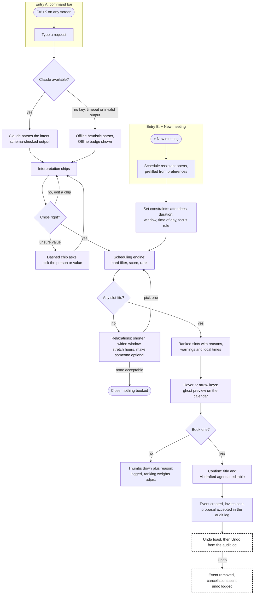

- **Edge paths:** if the AI is unavailable, the offline parser takes over and the badge says so. If nothing fits, Kairos offers relaxations and never relaxes silently. A rejected slot is fed back into ranking, and Esc closes without saving and returns focus to the trigger.
- **Autonomy:** at "Auto", the confirm step is skipped only for meetings you asked for yourself, and the Undo toast still appears.

### Flow 2 · Set smart reminders

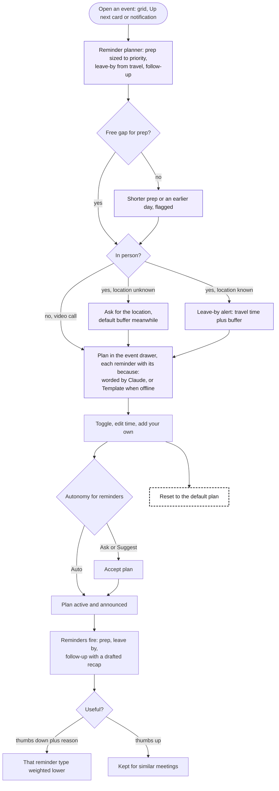

- **Edge paths:** no free gap leads to a shorter, flagged prep; an unknown location makes Kairos ask instead of guess; video calls never get a leave-by alert.
- **Undo:** switching a reminder off or choosing "Reset to default" restores the plain pop-up. Drafted recaps are never sent automatically.

### Flow 3 · View analytics and act on a recommendation

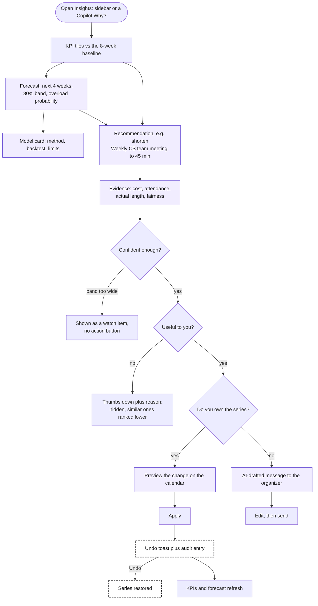

- **Edge paths:** low confidence produces a watch item with no action. Offline, the numbers are identical because they never come from the LLM; only the wording switches to templates.

### Flow 4 · Resolve a conflict

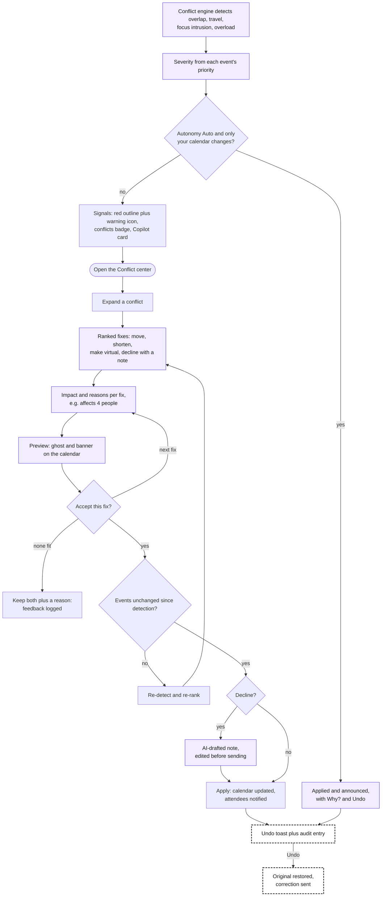

- **Edge paths:** if no fix fits, keep both and give feedback. If the calendar changed meanwhile, Kairos re-detects and re-ranks. Declining always shows the note before it is sent. Offline, detection and ranking are deterministic and keep working, and the notes come from templates.

## 5. Sequence: a scheduling request end to end

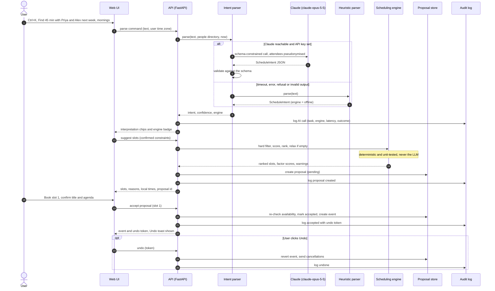

The reasons and the agenda draft are worded by Claude when it is available, and by templates when it isn't. Either way they are built from the engine's factor scores, so the explanation always matches the ranking.

## 6. Accessibility notes

The target is **WCAG 2.2 AA** on every screen, verified with automated scans plus manual keyboard and screen-reader passes.

- **Keyboard-first command bar.** Ctrl+K (⌘K on macOS) opens a modal dialog from anywhere: focus is trapped, and Esc closes it and returns focus to where it was. The input is an ARIA combobox whose results are a listbox navigated with ↑↓; Enter books through the confirm step, and Ctrl+Enter opens the assistant. Chips form a toolbar (arrow keys move between chips, Delete removes one). Result counts and engine fallbacks ("Parsed offline") are announced through a polite live region.
- **Focus management in drawers.** The Schedule assistant, Conflict center and Event drawer are non-modal, labelled regions. Opening one moves focus to its heading, and Esc closes it and returns focus to the trigger (the badge, "+ New meeting" or the event). F6 cycles between the grid, the drawer and the Copilot rail. The confirm step is inline, not a nested modal.
- **Color-independent conflict indicators (1.4.1).** Conflicts use a heavy outline, a ⚠ icon and a type word ("Overlap", "Travel"), and severity is written as a word. Reasons and warnings use ✓ and ⚠; attendee comfort uses ✓ / ◐ / ☾ plus text; categories are named in each event's accessible label.
- **WCAG 2.2 additions.** Focus Not Obscured (2.4.11): toasts and drawers never cover the focused element. Dragging Movements (2.5.7): every drag-to-move has a "Move to…" menu and a keyboard path. Target Size (2.5.8): at least 24×24 px, and 44 px on touch. Redundant Entry (3.3.7): constraints carry over from the command bar to the assistant.
- **Other AA targets.** Contrast is 4.5:1 for text and 3:1 for outlines, focus rings and score bars. Undo toasts pause on hover or focus, and Undo stays available in the audit log (2.2.1). Status messages use `role="status"` (4.1.3). Pages reflow at 320 px, animations respect `prefers-reduced-motion`, and every chart has a text summary and a table view.
- **Readable names.** Events read as, for example, "Brightwave Logistics — QBR, Friday Nov 27, 2:00 to 3:00 PM, conflict: overlaps Customer health review". Local times include the zone and a comfort word ("Priya, 9:30 PM IST, late evening").

## 7. Screenshots

These images are captured from the running app by the end-to-end tests. For the low-fidelity version of each screen, see the [wireframe board](../design/wireframes/index.html).

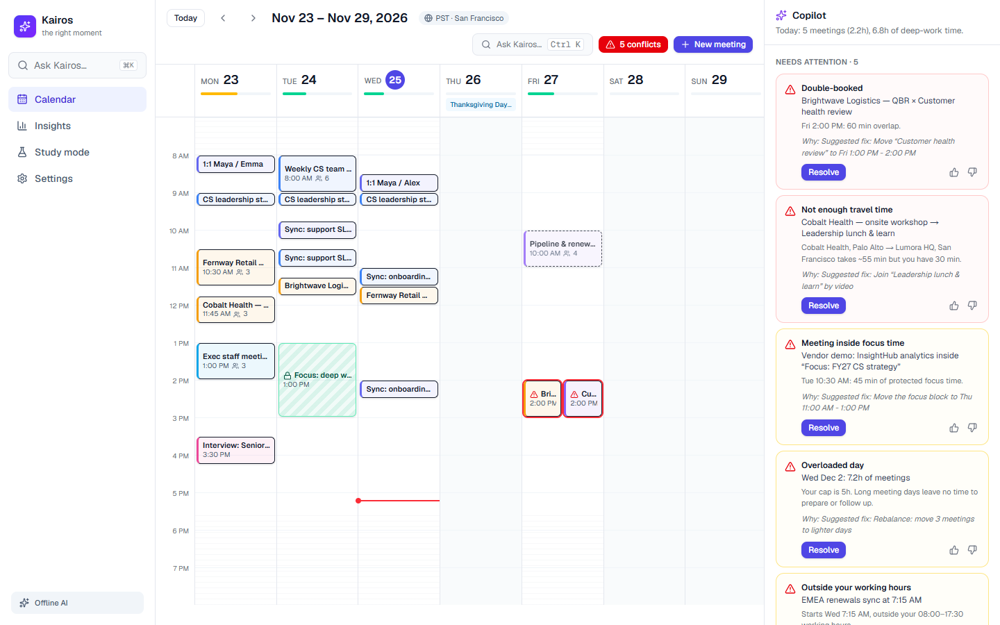
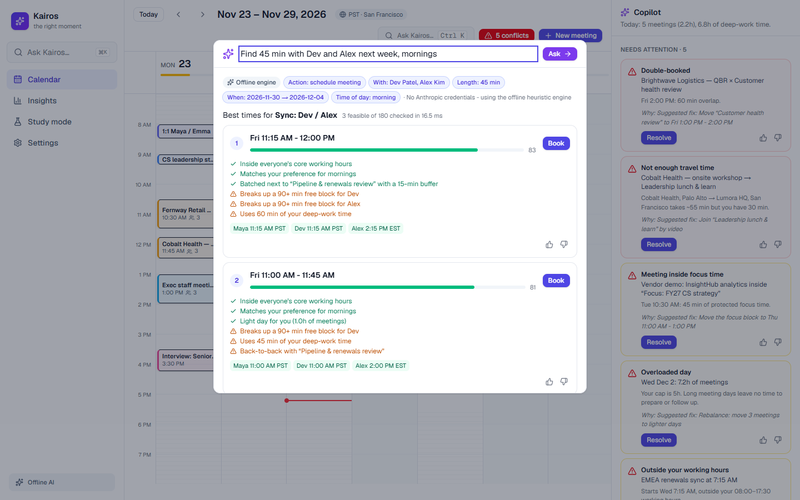
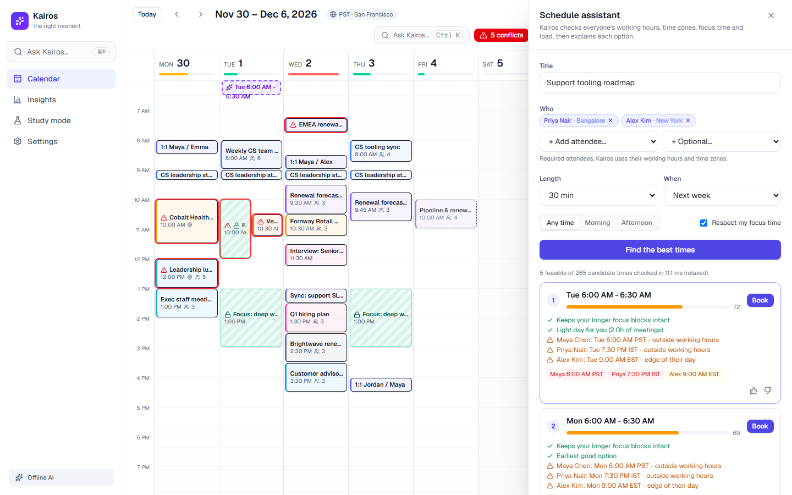
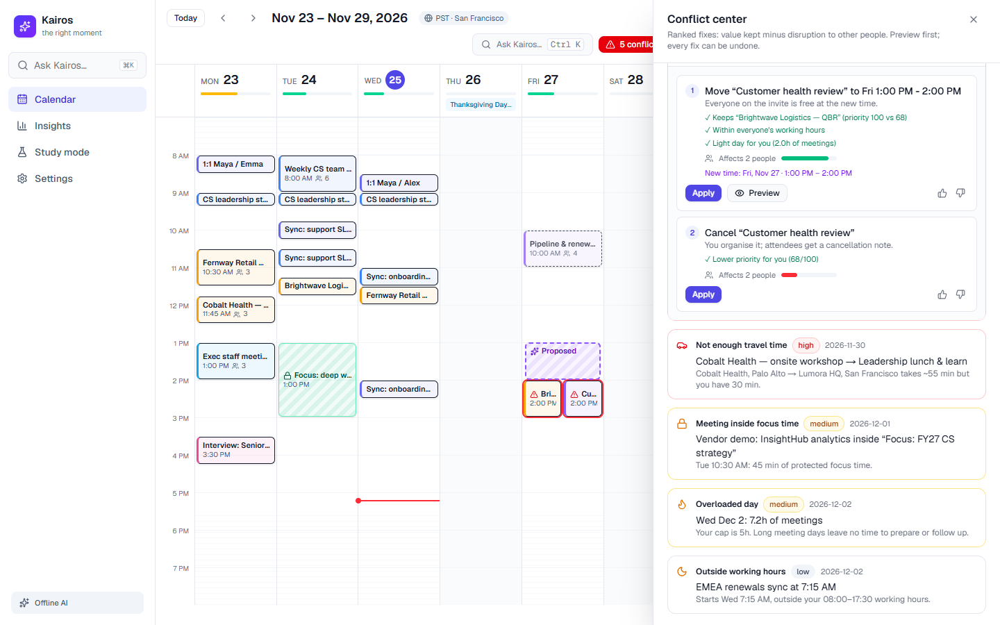
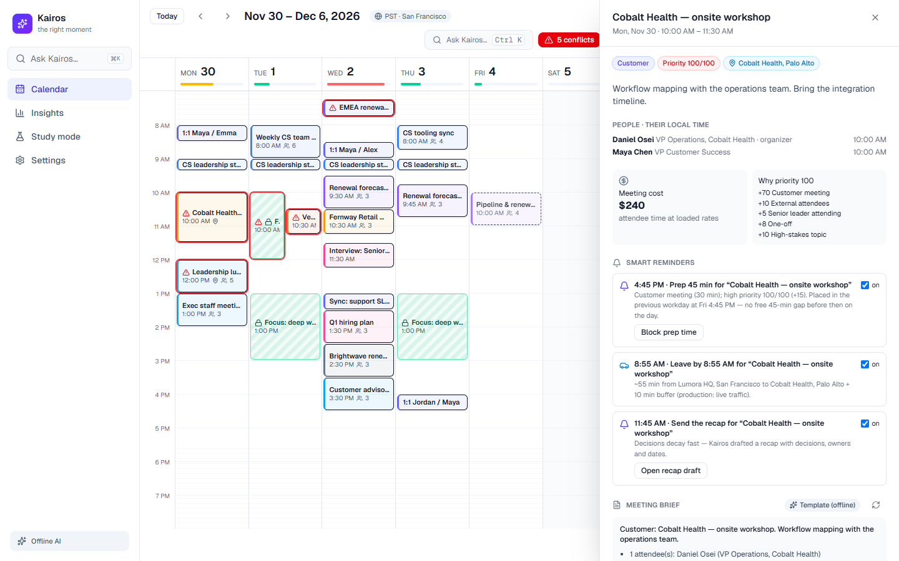
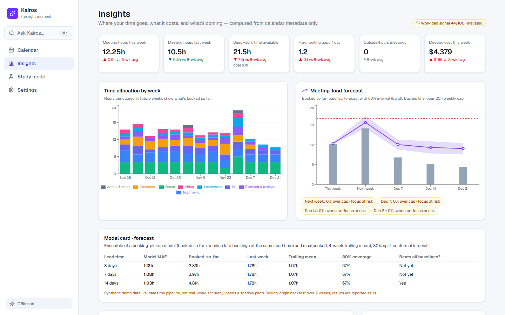
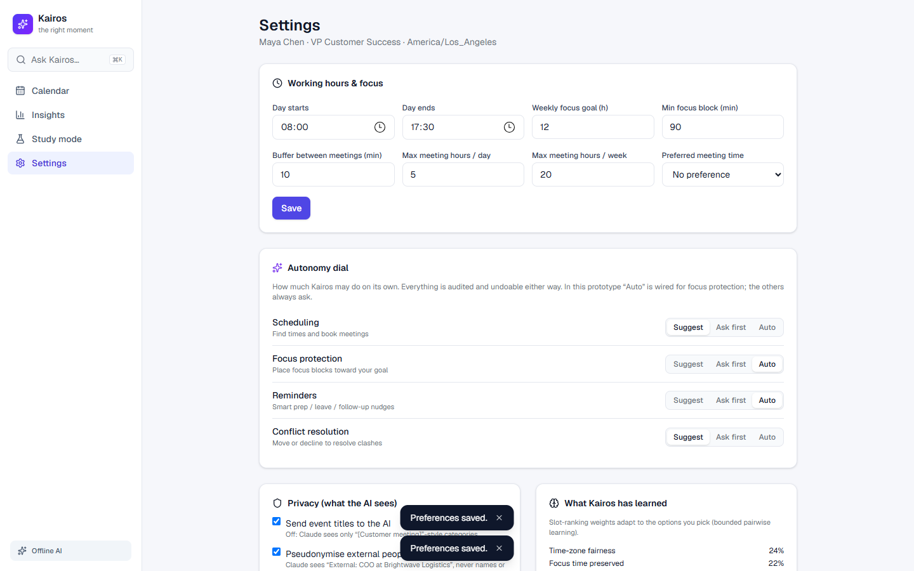
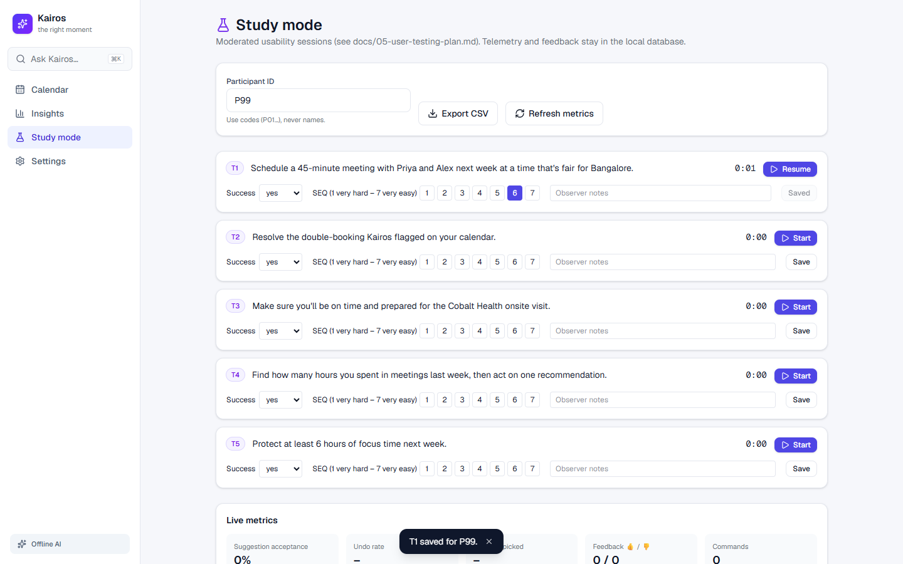
